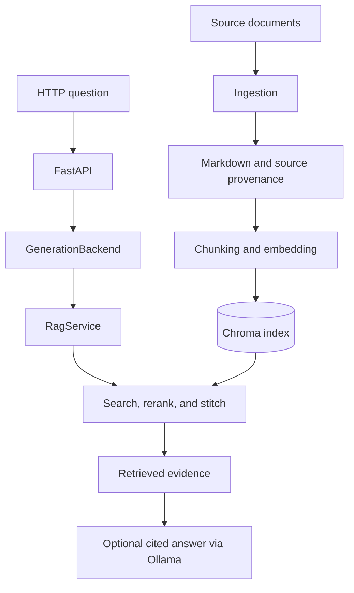

# Local RAG Engine

A local retrieval-augmented generation engine for technical support. It indexes
manuals and support articles, then serves retrieved evidence and cited answers
through FastAPI.

## What it supports

- Ingest plain text, Markdown, PDF, Word (`.docx`), and HTML.
- Search a Chroma index using embeddings and optional cross-encoder reranking.
- Ask free-form questions through the HTTP API, with optional alarm context.
- Generate answers with Ollama and cite the source document, section, or PDF page
  when available.

## Quick start

Use Python 3.14 and run these commands from the repository root. The index uses
the bundled example documents.

```bash
python3.14 -m venv .venv
source .venv/bin/activate
python -m pip install -r requirements/requirements-service.txt
export PYTHONPATH=src

python -m rag_engine.cli.index
RAG_RETRIEVAL_ONLY=1 python -m uvicorn rag_engine.serving.app:create_app --factory
```

Open [Swagger UI](http://127.0.0.1:8000/docs) and try `POST /api/v1/ask` with
`{"question": "What should I check if the demo worker is unavailable?"}`.
Retrieval-only mode returns the evidence and runs without Ollama.

- [Service setup](SETUP.md) covers Docker, Ollama, and runtime configuration.
- [Document ingestion](docs/ingestion.md) explains supported formats and converted files.
- [Benchmark guide](docs/benchmarks.md) covers evaluation.

## Architecture



| Module | Responsibility |
| --- | --- |
| [`ingestion/`](src/rag_engine/ingestion) | Converts source files to Markdown and records source locations, PDF page spans, and conversion diagnostics. |
| [`engine/vector_store/`](src/rag_engine/engine/vector_store) | Splits Markdown into chunks, attaches provenance and filterable metadata, embeds the chunks, and stores and searches them in Chroma. |
| [`engine/parse_input/`](src/rag_engine/engine/parse_input) | Prepares question text and metadata filters for search. It also parses alarm reports for the development tools. |
| [`engine/retrieve/`](src/rag_engine/engine/retrieve) | Embeds the query, retrieves matching chunks, and coordinates ranking and evidence selection. |
| [`engine/rerank/`](src/rag_engine/engine/rerank) | Supplies ranking strategies and stitches adjacent chunks into passages with their source IDs. |
| [`engine/llm/`](src/rag_engine/engine/llm) | Provides the Ollama client, evidence formatting, and structured alarm-answer helpers used by the development tools. |
| [`runtime/`](src/rag_engine/runtime) | `RagRuntime` holds the loaded embedder, index, and reranker. `RagService` uses those resources to turn a question into evidence and is shared by serving and evaluation. |
| [`serving/app.py`](src/rag_engine/serving/app.py) | Defines the FastAPI routes and registers the backend in `app.state` at startup. |
| [`serving/backend.py`](src/rag_engine/serving/backend.py) | Defines the backend interface that the routes call. |
| [`serving/concurrency/`](src/rag_engine/serving/concurrency) | Implements that interface with `GenerationBackend`. One worker handles blocking retrieval, and a separate bounded pool handles optional generation. |
| [`serving/models.py`](src/rag_engine/serving/models.py) | Defines the HTTP request and response schemas, including the shared evidence format. |
| [`serving/answers.py`](src/rag_engine/serving/answers.py) | Sends the question and retrieved passages to Ollama and validates the answer and its citation IDs. |
| [`cli/`](src/rag_engine/cli) | Provides commands for ingestion, index construction, and local development checks. |
| [`benchmarks/`](src/rag_engine/benchmarks) | Prepares labelled question sets and measures retrieval through the shared application path. |
| [`evaluation/`](src/rag_engine/evaluation) | Scores generated answers against references and evidence using similarity metrics or a model judge. |

Shared defaults, logging, and error types live in [`settings.py`](src/rag_engine/settings.py),
[`logging_config.py`](src/rag_engine/logging_config.py), and [`exceptions.py`](src/rag_engine/exceptions.py).
The repository also includes [`examples/`](examples) for local setup,
[`data/`](data/README.md) for raw and processed corpus artifacts, and [`tests/`](tests)
for automated checks.
